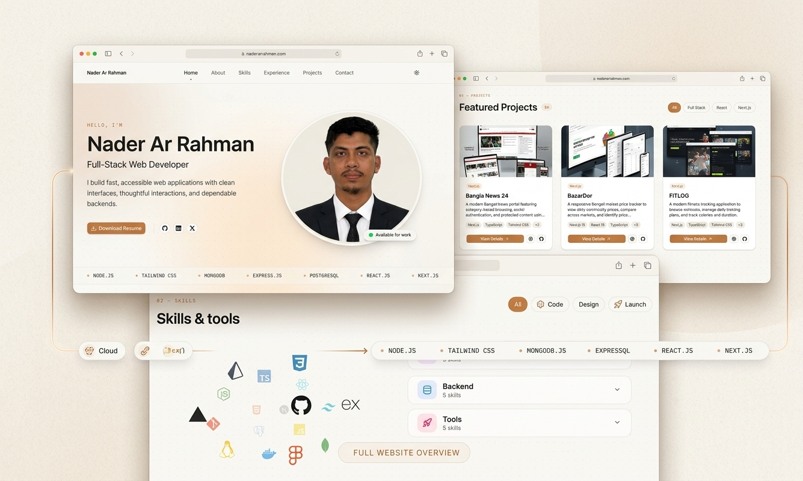

<div align="center">

# 🚀 Nader Ar Rahman - Portfolio

<p>A modern, fully responsive personal portfolio website showcasing my skills, projects, and professional journey.</p>

<a href="https://nextjs.org/">
  
</a>
<a href="https://tailwindcss.com/">
  
</a>
<a href="https://www.typescriptlang.org/">
  
</a>
<a href="https://vercel.com/">
  
</a>

### 🌐 [Live Demo](https://naderarrahman.vercel.app)

</div>

---

## 📸 Project Overview



---

## 📖 About The Project

This portfolio is designed to be clean, minimal, and interactive. It goes beyond a standard static portfolio by integrating a fully functional contact form, dynamic project filtering, and an interactive 3D skills visualization. The UI features a warm aesthetic with smooth animations and full dark/light mode support.

## ✨ Key Features

- **Interactive Hero Section:** Features a custom Typewriter effect for dynamic designations and an animated Aurora/Fluid background.
- **Dynamic Skills Section:** An interactive 3D rotating globe (`react-icon-cloud`) to visualize tech stacks, categorized by Frontend, Backend, and Tools.
- **Filterable Projects Directory:** Users can filter projects dynamically. Each project has a dedicated details page showcasing the tech stack, challenges, and future plans.
- **Functional Contact Form:** Integrated with the **Resend API** to securely send emails directly to my inbox without exposing my actual email address in the code.
- **Fully Responsive:** Optimized for desktop, tablet, and mobile screens.
- **Dark/Light Mode:** Seamless theme switching using `next-themes`.
- **Smooth Scrolling & Animations:** Powered by `framer-motion` and custom CSS animations.

## 🛠️ Tech Stack

| Category | Technologies |
| :--- | :--- |
| **Framework** | Next.js (App Router) |
| **Language** | TypeScript |
| **Styling** | Tailwind CSS v4, shadcn/ui |
| **Animations** | Framer Motion, Tailwind Animate |
| **Icons** | Lucide React, React Icons, Custom SVGs |
| **Email Service** | Resend |
| **Theme** | next-themes |
| **Deployment** | Vercel |

## 📂 Folder Structure

```text
portfolio/
├── public/
│   ├── certificates/
│   ├── hero-image/
│   └── projects/
├── src/
│   ├── app/
│   │   ├── api/
│   │   │   └── contact/
│   │   └── projects/
│   │       └── [slug]/
│   ├── components/
│   │   ├── layout/
│   │   ├── sections/
│   │   └── ui/
│   ├── data/
│   └── lib/
├── .env.local
├── package.json
└── ...config files
```

## 🚀 Getting Started Locally

### Prerequisites

Make sure you have Node.js (v18 or higher) and npm installed.

### 1. Clone the Repository

```bash
git clone https://github.com/naderarrahman/your-portfolio-repo.git
cd your-portfolio-repo
```

### 2. Install Dependencies

```bash
npm install
```

### 3. Configure Environment Variables

Create a `.env.local` file in the root directory and add the following variables. You will need to get an API key from [Resend](https://resend.com/api-keys).

```env
RESEND_API_KEY=your_resend_api_key_here
CONTACT_EMAIL=your_email@example.com
```

**Important:** Never commit your actual API key to GitHub. Make sure `.env.local` is included in your `.gitignore` file.

### 4. Run the Development Server

```bash
npm run dev
```

### 5. View in Browser

Open [http://localhost:3000](http://localhost:3000) with your browser to see the result.

## 🔮 Future Enhancements

- [ ] Add a blog section for writing technical articles.
- [ ] Implement an admin dashboard for managing projects dynamically.
- [ ] Add internationalization (i18n) support for multiple languages.
- [ ] Improve accessibility and keyboard navigation.

## 👨‍💻 Connect With Me

- **Portfolio:** [naderarrahman.vercel.app](https://naderarrahman.vercel.app/)
- **GitHub:** [@naderarrahman](https://github.com/naderarrahman)
- **LinkedIn:** [Nader Ar Rahman](https://www.linkedin.com/in/naderarrahman/)
- **Email:** [naderarrahman@gmail.com](mailto:naderarrahman@gmail.com)

---

<p align="center">
  Built with ❤️ using Next.js, Tailwind CSS & Framer Motion.
</p>
